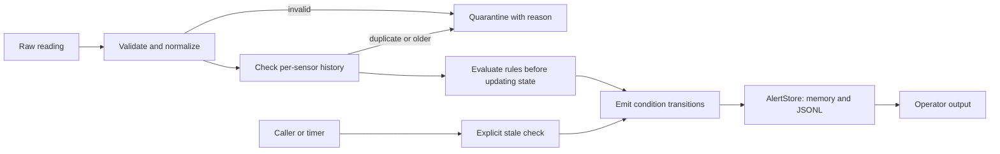

# Sensor Monitoring and Operator Decision Support

## How it works

This component accepts temperature and pressure readings from multiple sensors
and flags concerning conditions for an operator. It makes no automatic control
decisions. Temperature limits apply only to temperature; validation, stale
checks, and flatline detection apply to both types.

`parsing.py` validates each input, and `rules.py` checks for abnormal conditions.
`monitor.py` keeps sensor history, decides when to raise or clear alerts, and
saves them. `models.py` defines readings, configuration, sensor state, and alerts.
Validation errors are caught in one place, `SensorMonitor.process()`, which
returns the rejected input and its reason in a `QuarantineRecord`.

## Architecture trade-offs

| Choice | Why | Cost |
|---|---|---|
| Separate rules from the monitor | Detection can be tested independently; history, alert state, and storage stay in one coordinator. | A few small classes instead of one function. |
| Reject late readings rather than reorder them | Keeps the rate baseline chronological without buffering or waiting. | Late observations are excluded from detection. |
| Alert on condition changes | Avoids repeating the same alarm on every reading. | An ongoing condition gets no reminders or acknowledgement tracking. |
| Let the caller schedule stale checks | No background thread or scheduler inside the component. | Detection and recovery can be delayed until the next check. |
| Keep sensor state in memory and append alerts to JSONL | Easy to run and inspect without a database. | State is lost on restart; memory and file size grow, and writes lack crash guarantees. |

## Assumptions and validation

- Readings arrive roughly once per second. Sensor identity plus timestamp
  identifies one observation. Each sensor has its own history and a fixed
  measurement type. Readings with both measurement fields, or a changed sensor
  type, are quarantined to avoid mixing units.
- Timestamps use ISO-8601 and are converted to UTC. Timestamps without a
  timezone are rejected unless `assume_utc_if_naive` is explicitly the boolean `True`.
- Readings more than two seconds into the future are rejected by default.
  `process(raw, now=...)` accepts an explicit current time for tests or replay.
  Without `now`, it uses the computer's UTC clock. Older readings have no age
  cutoff, so recorded readings can be replayed.
- Each reading contains either `temperature_c` or `pressure_bar`. Values must
  be numeric, excluding booleans. Temperature uses configurable physical bounds,
  defaulting to -50 through 2000 degrees Celsius. Pressure is absolute, in bar,
  and must be finite and nonnegative. Missing fields, malformed timestamps,
  overflow, and implausible values are quarantined.
- Pressure deliberately has no process limits or upper physical bound. The
  alarm and rate engine is type-agnostic and ready to apply them, but inventing
  high-pressure or pressure-rise thresholds without real equipment data would
  risk false alarms or masked faults in a safety context. Defining real limits
  later is configuration, not new code.
- Configuration rejects boolean numeric values, NaN (not a number) or infinite limits, reversed
  ranges, negative rate limits or future tolerance, and non-positive stale or
  flatline durations. The timezone option must be an actual boolean.

Quarantined readings do not update accepted state or refresh the stale timer.
The caller receives the quarantine record and decides how to retain it.

## History and detection

A timestamp equal to the sensor's last accepted timestamp is a duplicate; an
older timestamp is out of order. Both are quarantined without changing the
previous value used by later rate calculations.

| Condition | Detection and response |
|---|---|
| High temperature | Value strictly above `high_temperature_alarm_celsius`: ALARM. Equality does not raise this alarm. |
| Temperature rate of rise | `(value - previous_value) / elapsed_minutes` strictly above the configured rate: ALARM. Uses consecutive accepted readings and guards against non-positive elapsed time. |
| Stale data (both types) | `check_stale_sensors(now)` raises ALARM when elapsed time since the last accepted timestamp exceeds the stale threshold. The caller must schedule these checks. Recovery clears on the next check. |
| Temperature outside normal band | Optional WARNING below or above the normal range, suppressed above the high-temperature threshold. |
| Flatline (both types) | Optional ALARM for identical values lasting the configured window. A stale gap restarts that window. Equal samples are a heuristic, not proof of a stuck sensor. |

Rules run before state updates so they see the previous reading and the start
of any unchanged-value run. Sensors are tracked after their first accepted
reading. Detecting a sensor that never reports requires a separate list of
expected sensors.

## Repeated alerts

Each sensor keeps a set of active conditions. A new condition produces one
`RAISED` alert. Further readings with the same condition produce no additional
alerts. When the condition ends, the monitor produces one `CLEARED` alert. If
it happens again later, it can raise again.

## Alert records and storage

Each structured alert contains event time, sensor ID, condition, severity,
status, violated rule, observed value, threshold, unit, and a readable message.
Rate alerts also contain `previous_value`, `previous_timestamp`,
`elapsed_minutes`, and `observed_rise_degrees_celsius_per_minute`. For example,
600 to 601 degrees Celsius over 0.5 seconds gives 120 degrees Celsius/minute;
those values and the interval remain in the record for inspection.

High-temperature, rate, stale, and flatline alerts use ALARM severity; normal-band
warnings use WARNING. Clears use INFO. The operator line is formatted from the
same alert. Flatline observations and thresholds are recorded in seconds.

`AlertStore` retains alerts in memory and optionally appends one JSON object per
line to a JSONL file. Reopening a store preserves existing records. If a file
write fails, the error reaches the caller and the alert remains available for
retry. The caller must retry after fixing the storage problem. Writes are not
guaranteed to survive a crash or power loss. Sensor state is lost on restart.

## Test examples

The unittest suite uses real temporary files, without mocks. Shared validation,
history, stale, and flatline checks run for both measurement types:

- Mixed temperature and pressure readings keep independent state, and Celsius
  limits never trigger pressure alarms.
- Duplicate, older, and timezone-equivalent readings are rejected without
  corrupting the next rate calculation.
- A sub-second rise records both values, the interval, and the expected rate
  in JSONL. A rate exactly at the limit remains silent.
- Stale checks respect the threshold, emit once, and clear after recovery;
  another sensor's state remains independent.
- Malformed readings retain rejection reasons and do not postpone staleness.
- Reopening storage preserves history; a failed alarm write can be retried.

Each module also has a small runnable check.

## Production and safety considerations

1. **Independent evidence:** A plausible but incorrect sensor can hide a real
   condition or create a false alarm. Multiple sensors measuring the same point
   could help operators compare readings and check whether they agree. The
   monitor would still make no control decisions.
2. **Durable history and recovery:** Persist sensor state alongside a durable
   alert log that reveals changes to recorded entries. Define how to recover
   after write failures and restarts.
