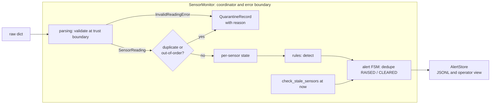
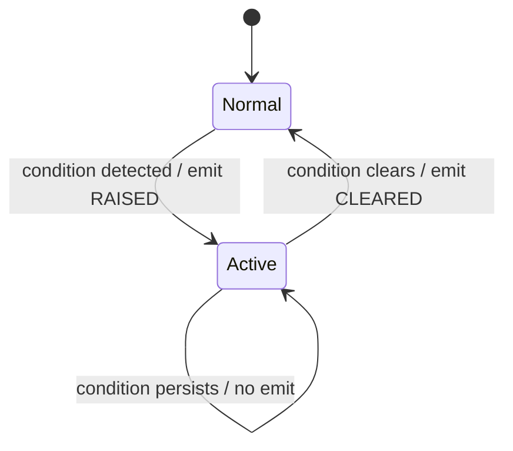

# Design Note: Sensor Monitoring & Operator Decision Support

## 1. Component boundaries and data flow

Four responsibilities, each in its own module, with one trust boundary and one
error boundary.

- **parsing** validates a reading *in isolation* and either returns a
  `SensorReading` or raises `InvalidReadingError`. It is the **trust boundary**:
  nothing downstream re-validates format.
- **monitor** (`SensorMonitor`) is the coordinator and the single **error
  boundary**: the one `try/except` in the codebase lives in `process()` and
  converts a bubbled-up `InvalidReadingError` into a `QuarantineRecord`. It owns
  per-sensor state, the duplicate/out-of-order decision, the alert state
  machine, and persistence.
- **rules** are pure detection algorithms validated against reading + state.
- **AlertStore** persists alerts as append-only JSON Lines.

Low-level code never catches its own errors; they bubble to the coordinator
whose job is to decide recovery (quarantine). Native timestamp parsing errors
and numeric overflow also propagate to that boundary. This keeps each validator a flat
sequence of guard clauses.

## 2. Assumptions

Each is a deliberate, tunable choice, not a hidden default.

| Assumption | Choice | Why | Revisit if |
|---|---|---|---|
| Timestamp timezone | ISO-8601 UTC; **naive rejected** (opt-in `assume_utc_if_naive`) | An ambiguous clock reference is a data-quality failure in a safety context | The fleet emits naive UTC by spec |
| Future-dating | Reject beyond `future_tolerance_seconds` (default 2.0) | Real sensor/host clocks drift a few seconds; future readings corrupt staleness and rate math | Tight time-sync is guaranteed |
| Duplicate identity | `sensor_id + timestamp` | A second value for one instant is a fault, not new information; including `value` would let a flipped reading pass | Sensors report sub-second |
| Physical plausibility | Value within `physical_range_celsius` (default −50…2000) | A non-physical value is a *sensor fault*, not a process alarm; it must not trip a false HIGH_TEMPERATURE | Real sensor spec differs (supply real bounds) |
| Staleness detection | Explicit `check_stale_sensors(now)` call | A prototype has no scheduler; production calls this on a timer | none |

Timestamps are normalized to UTC at the boundary; values are `float` with the
unit carried in a field, never in the name.

## 3. Validation behavior (three tiers)

1. **Well-formed?**, required fields present, value numeric (`bool` rejected so
   `True` can't become `1.0`), timestamp parseable. → quarantine.
2. **Trustworthy clock?**, timezone-aware, not future-dated. → quarantine.
3. **Physically possible?**, value within the physical range. → quarantine as
   bad data (a sensor fault), separate from a process alarm.

A rejected reading becomes a structured `QuarantineRecord` with a reason, never
a silent drop and never a bare log string.

## 4. Duplicate and out-of-order handling

Both decisions need per-sensor history, so they live in the monitor, not the
parser:

- **Duplicate** (`timestamp == last accepted`) → quarantine; **state untouched**.
- **Out-of-order** (`timestamp < last accepted`) → quarantine; **state untouched
  and excluded from rate-of-rise**. A late low reading must not become the
  baseline for a later rate calculation, that would fabricate a large,
  misleading rate.

## 5. Stale-data handling

The monitor cannot detect "no message arrived" purely reactively. For the
prototype, `check_stale_sensors(now)` computes idle time per sensor and drives a
`STALE_DATA` condition through the same alert state machine. A production system
invokes this periodically (timer / scheduler). An invalid reading does **not**
refresh the stale timer, only an accepted reading does. Recovery clears on the
next explicit stale check. Future-date validation accepts an injected `now` in
`process(raw, now=...)`; omitted `now` uses the host UTC clock. Historical
readings have no age cutoff, allowing replay. Configuration rejects non-finite thresholds, reversed ranges, negative rate
limits or clock tolerance, and non-positive stale or flatline durations.

## 6. High-temperature and rate-of-rise handling

- **High temperature**: `value > high_temperature_alarm_celsius` → ALARM.
- **Out-of-band** (added): outside `normal_range_celsius` but at or below alarm →
  WARNING, both directions. Stays silent above the alarm so it does not
  double-fire with high-temperature.
- **Rate of rise**: `rate = (value − previous_value) / elapsed_minutes`, measured
  against the immediately preceding *accepted* reading. Because duplicates and
  out-of-order readings are already filtered, that baseline is always
  chronologically prior, so the formula is well-defined. Guards: non-positive
  elapsed → no alert (no divide-by-zero); decreasing value → negative rate → no
  alert. The alert records `previous_value`, `previous_timestamp`,
  `elapsed_minutes`, and the observed rate so an operator can judge a short
  interval (a sub-second gap yields a large but honest rate).
- **Flatline** (added): identical value held for `flatline_window_seconds` →
  ALARM. This is a heuristic: equal endpoints can span missing samples, so it
  cannot prove continuous frozen data. A gap exceeding the stale threshold
  restarts the flatline window.

## 7. Repeated-alert policy: state-transition alerts

Each `(sensor, condition)` pair is a two-state FSM:

Implemented as `SensorState.active_conditions: set[AlertType]`, membership *is*
the state. An operator is alerted once when a condition appears and once when it
resolves, never every second while it persists. We rejected the GoF State
pattern (separate state classes) because there is no state-dependent *behavior* -
only whether to emit, which one set-membership check expresses.

## 8. Alert format (two views, one source of truth)

The structured `Alert` is the source of truth; the operator line is formatted
*from* it.

- **Record (JSONL, machine/audit):** `event_timestamp, sensor_id, alert_type,
  severity, status, rule_violated, observed_value, threshold, unit, message`,
  plus `previous_value / previous_timestamp / elapsed_minutes /
  observed_rise_degrees_celsius_per_minute` where relevant. Rate alerts include enough values and timing to recompute the rate.
  Flatline records use elapsed seconds and a seconds threshold. These four rate-specific fields appear
  only on rate-of-rise alerts; `Alert.to_dict()` omits any field that is `None`,
  so every record stays compact and carries only what applies to it.
- **Operator console (human):**
  `[14:05:02Z] ALARM   T-101  high_temperature  T-101 at 700.0 celsius, alarm at 675.0. -> RAISED`
  Severity-prefixed for triage; `RAISED`/`CLEARED` so resolution is visible.

Severity tiers: ALARM (high-temp, rate, stale, flatline), WARNING (out-of-band),
INFO (any CLEARED).

## 9. Persistence / record format

Append-only JSON Lines, one alert per line. Human-readable, `grep`/`jq`/pandas
friendly, no database. `AlertStore` also keeps alerts in memory for tests and the
operator view. "Append-only" is deliberate: a recorded alert is a fact and is
never rewritten. File errors propagate to the caller. Failed writes leave
the condition transition pending for retry; the caller must retry the reading
or stale check after storage recovers. This does not provide crash-safe disk
transactions or power-loss durability.

## 10. Test cases (incl. edge cases)

Per-module self-checks provide runnable smoke checks. Tests in
`tests/test_monitor.py` cover stream behavior; `tests/test_persistence.py`
checks real file writes, failed-write retry, and stored rate evidence;
`tests/test_config.py` checks configuration rejection. Highlights:

1. **Duplicate does not mutate state** (regression anchor), a duplicate is
   quarantined and `last_accepted_reading` is unchanged. Guards the invariant
   that corrupt/late data can't silently move current state.
2. **Stale alert not re-emitted** (regression anchor), two consecutive stale
   checks produce one RAISED, not two. Guards operator-spam prevention.
3. **Out-of-order does not feed rate-of-rise** (edge), a late low reading is
   rejected and does not become the rate baseline, so no fabricated spike.
4. **Very short interval** (edge), a sub-second gap yields a large but honest
   rate, and the alert records the exact interval used.
5. **One sensor stale does not affect another** (edge), per-sensor isolation.
6. **Persistence failures**, real file errors leave raised and cleared alerts
   available for retry; stored rate records retain the values and interval.

## 11. Design patterns

| Pattern | Decision | Reason |
|---|---|---|
| **Strategy** (detection rules) | **Selected**, for the reading-driven rules | Each rule is one responsibility, independently testable; the monitor coordinates without inlining every algorithm. Cost is one `Protocol` + small classes. Stale is deliberately *not* a Strategy, it is time-driven and does not fit the per-reading signature; forcing it in would be ceremony. |
| **FSM as a set** | **Selected** | `active_conditions` set gives one-line transitions and dedup. |
| **GoF State** | Rejected | No state-dependent behavior to justify state classes. |
| Adapter | Rejected | One wire format; the parser's key-map is the extension point for a second. |
| Observer | Rejected | One consumer (`AlertStore`); no decoupling needed. |
| Chain of Responsibility | Rejected | Validation is a handful of guard clauses, not a deep pipeline. |
| Factory Method | Rejected | Object creation doesn't vary by subtype. |

### Data model note

`SensorReading` carries `measurement_type`, `value`, and `unit` rather than a
`temperature_c` field, so a pressure sensor slots in without reshaping the model,
while staying type-safe (`value` is always `float`). Only temperature rules are
implemented because the given config is temperature-specific, building
unconfigurable pressure rules would be speculative. The ambiguous wire keys
(`temperature_c`, `normal_range_c`, …) are mapped to clear internal names at the
parsing/config boundary.

### Correctness subtlety

Rules evaluate *before* the state update in `process()`. This is required for
flatline: the rule must see the start of the hold, and the clear-on-movement
works because `flatline_value` has not yet been reset when the rule runs.

## 12. What I'd revisit for a production, safety-significant system

Two, chosen over a long list:

1. **Redundant / voting monitoring.** This prototype watches each sensor
   independently, so a single sensor that lies, reads plausibly but wrong, can
   mask a real condition or raise a false one. A safety-significant deployment
   would monitor redundant sensors on the same physical point and require
   agreement (e.g. 2-out-of-3 voting), to improve operator evidence without making automatic control decisions. This is the single most important change and the one detection idea
   I deliberately left out of the prototype as out of scope.

2. **Durable, replayable, append-only state.** State here is in-memory and the
   JSONL store is best-effort. A production system would persist both the alert
   audit log and per-sensor state durably, so a restart replays from the record
   rather than losing history, and every alert is a tamper-evident, append-only
   entry. (Append-only auditability and deterministic replay are patterns I've
   worked with directly; they map cleanly onto this monitoring problem without
   needing any additional infrastructure in the prototype.)
