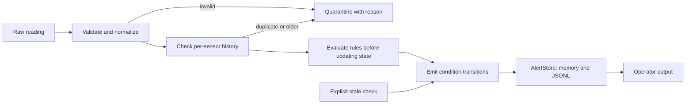

# Sensor Monitoring and Operator Decision Support

## Boundaries and data flow

This component accepts temperature readings from multiple sensors and reports
conditions for an operator. It makes no automatic control decisions. Pressure
measurement handling is outside this implementation because the supplied
configuration defines temperature rules only.

`parsing.py` validates input; `rules.py` detects reading-driven conditions;
`monitor.py` coordinates history, transitions, and storage. `models.py` holds
readings, configuration, state, and alerts. Validation errors propagate to the
single exception boundary in `SensorMonitor.process()`, which returns a
`QuarantineRecord` containing the original input and a reason.

## Assumptions and validation

- Readings arrive roughly once per second. Sensor identity plus timestamp
  identifies one observation; different sensors maintain independent state.
- Timestamps are ISO-8601, normalized to UTC. Naive timestamps are rejected
  unless `assume_utc_if_naive` is explicitly the boolean `True`.
- Readings more than two seconds into the future are rejected by default.
  `process(raw, now=...)` accepts an injected clock value; omitted `now` uses
  host UTC time. Historical readings have no age cutoff, allowing replay.
- Values must be numeric, excluding booleans, and within the configurable
  physical range, defaulting to -50 through 2000 degrees Celsius. Missing
  fields, malformed timestamps, overflow, and implausible values are quarantined.
- Configuration rejects boolean numeric values, non-finite limits, reversed
  ranges, negative rate limits or future tolerance, and non-positive stale or
  flatline durations. The timezone option must be an actual boolean.

Quarantined readings do not update accepted state or refresh the stale timer.
The caller receives the quarantine record and decides how to retain it.

## History and detection

A timestamp equal to the sensor's last accepted timestamp is a duplicate; an
older timestamp is out of order. Both are quarantined without changing the
baseline used by later rate calculations.

| Condition | Detection and response |
|---|---|
| High temperature | Value strictly above `high_temperature_alarm_celsius`: ALARM. Equality does not raise this alarm. |
| Rate of rise | `(value - previous_value) / elapsed_minutes` strictly above the configured rate: ALARM. Uses consecutive accepted readings and guards against non-positive elapsed time. |
| Stale data | `check_stale_sensors(now)` raises ALARM when elapsed time since the last accepted timestamp exceeds the stale threshold. The caller must schedule these checks. Recovery clears on the next check. |
| Outside normal band | Optional WARNING below or above the normal range, suppressed above the high-temperature threshold. |
| Flatline | Optional ALARM for identical values lasting the configured window. A stale gap restarts that window. Equal samples are a heuristic, not proof of a stuck sensor. |

Rules run before state updates so they see the previous reading and the start
of any unchanged-value run. Sensors are tracked after their first accepted
reading; detecting a sensor that never reports requires an external roster.

## Repeated alerts

Each sensor maintains a set of active conditions. A condition becoming active
emits one `RAISED`; persistence emits nothing; recovery emits one `CLEARED`.
A later recurrence can raise again. This avoids reporting the same condition
on every reading.

## Alert records and storage

Each structured alert contains event time, sensor ID, condition, severity,
status, violated rule, observed value, threshold, unit, and a readable message.
Rate alerts also contain `previous_value`, `previous_timestamp`,
`elapsed_minutes`, and `observed_rise_degrees_celsius_per_minute`. For example,
600 to 601 degrees Celsius over 0.5 seconds gives 120 degrees Celsius/minute;
those values and the interval remain in the record for inspection.

High-temperature, rate, stale, and flatline alerts use ALARM severity; normal-band
warnings use WARNING. Clears use INFO. The operator line is formatted from the
same alert. Flatline observations and thresholds are recorded in seconds.

`AlertStore` retains alerts in memory and optionally appends one JSON object per
line to a JSONL file. Reopening a store preserves existing records. File errors
propagate, leaving the failed transition pending; callers must retry after
storage recovers. This prototype provides neither crash-safe transactions nor
power-loss durability. State is lost on restart.

## Test examples

The unittest suite uses real temporary files, without mocks:

- Duplicate, older, and timezone-equivalent readings are rejected without
  corrupting the next rate calculation.
- A sub-second rise records both values, the interval, and the expected rate
  in JSONL. A rate exactly at the limit remains silent.
- Stale checks respect the threshold, emit once, and clear after recovery;
  another sensor's state remains independent.
- Malformed readings retain rejection reasons and do not postpone staleness.
- Reopening storage preserves history; a failed alarm write can be retried.

Module self-checks provide additional runnable smoke checks.

## Production and safety considerations

1. **Independent evidence:** A plausible but incorrect sensor can hide a real
   condition or create a false alarm. Redundant sensors and voting could improve
   operator evidence; this component would still make no control decisions.
2. **Durable history and recovery:** Persist sensor state alongside a durable,
   tamper-evident alert log, with defined failure and restart behavior. The
   current in-memory state and simple JSONL writer are demonstration choices.
